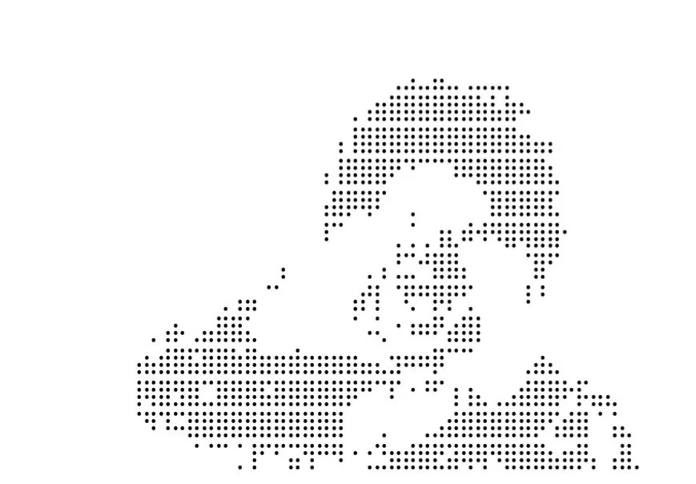

**[Title] Holding My Breath Until Mangostick Comes Back**

Sip

=Comments=

**[??: Doctor, it says "until Mangostick returns"... (peering into the coffin)]**

**[The author's dead. Please delete the post ^^]**

**[(Already-deceased post author)]**

\*

**[Title] Seriously, Mangostick vanished and my life went to hell**

Back when Mangostick still streamed,

even on the crappiest days I'd watch Apple-Mango clips and crack up,

rewatch Mangostick mad-movies and laugh till I cried.

Now that she's gone, everything feels gray.

No matter how good the news,

I stand in the shower and mutter, "How many days since Mangostick's last stream?"

"Day 93," I answer myself—and end up sobbing.

Now I get the saying: "Mangoes make people."

=Comments=

**[Sir....]**

**[This is clinical mango addiction.]**

**[My YouTube homepage looks so empty without his mad-movies.]**

**└[For real. I actually miss that random Egostic broadcast-hijack more than regular TV.]**

\*

**[Title] Mangostick, where are you? Come back come back**

comebackcomebackcomebackcomebackcomebackcomeback—

gnaw... crunch... gnaw... crunch... gnaw... crunch...

=Comments=

**[Holy hell this is creepy]**

**[What even is this lol]**

**[Just another soul Mangostick broke...]**

**[What's the gnawing noise?]**

**└[Nail-biting, probably.]**

**└[Straight-up madness shiver]**

\*

**[Title] Yeah, keep hiding, Mangostick lolol**

Just kill myself

lololol

=Comments=

**[Finally lost it]**

**[Seen this troll before]**

**[Go on, do it—dozens have already]**

**[Post like this? She'll stay gone even longer]**

**[Yeah, kill yourself~ hiding fixes everything~]**

**└[...damn]**

\*

**[Title] Actually, Mangostick came back ages ago**

(photo of an ice-mango stick being eaten)

Tastes amazing hehe

=Comments=

**[You're... eating Mangostick?]**

**[Whoa, that looks kinda lewd]**

**[You fiend... Egostic belongs... to Stardus...]**

**└[Toxic We-Got-Married fan spotted]**

**└[Egostic's in the basement, officer]**

**└[How'd you know;;]**

**└[?]**

**[Mangostick's... stick...]**

**└[Manager, please ban this user]**

**└[? I'm innocent]**

\***

"...*Sigh*."

Shin Haru scrolled through Egostic's fan-cafe and exhaled.

She'd even joined the place, hoping someone might know where the streamer had vanished to, but the trending posts were nothing but shitposts.

Three months. Long or short, depending how you counted.

Yet for someone who used to trigger chaos every few weeks, Egostic's ninety-day silence was downright bizarre.

Thanks to it, the city had been... peaceful.

Sure, other villains still popped up, but a few punches and they were done—petty thugs compared with the man who'd sink ships and *crash* planes.

Lately Haru's days had slipped into an easy calm.

Still—

"...It's eerie."

Exactly. Like the breathless hush before a typhoon, this quiet felt like the prelude to something far worse.

What on earth had he been plotting for three straight months? The thought alone made her stomach knot.

...

In lectures,

studying lattes with her senior,

lounging at home,

even while pounding lesser villains—

the same unease gnawed deep in her chest.

She'd been ready: next time they met she'd wring out his plan, his goal, whatever it took—

but he never showed, and there was nothing she could do.

She'd even tried venting this unease to her friend Icicle, but—

**[Aw, Haru. You worry about everything. He probably just wants a break too. Does it make sense for someone to do nothing but eat and commit terror attacks? Don't worry~.]**

That was the only response she got.

"Haah..."

Right, logically speaking, there was no need to worry about that guy anymore.

In fact, it'd be better if he didn't show up. It'd be fine if he never appeared again, ever.

Just as she was thinking that, her intuition whispered to her.

'Really?'

"....."

Right.

Let's be honest.

Even if he was going to disappear, she wanted to figure out what he'd been thinking all this time before he vanished.

Why did he kill those other villains?

Why did he tell her to save people?

If that was his goal, why did he commit terror attacks?

...Are you a villain cosplaying as a hero, or a hero cosplaying as a—

At that moment, the office door burst open.

"Stardus!"

"Huh?"

Lost in quiet thought, she was so startled by the sudden intrusion that she bit her tongue.

Only then did Shin Haru realize she wasn't at a cafe.

Her university exams were over, and the rest of her schedule consisted of camping out in her office at the Hero Association.

Which meant this Association employee had come running because—

"Another incident?"

"Yes, some villain is committing a terror attack in Mapo District right now!"

"Really? Who's the villain?"

She asked with a hint of anticipation, but the answer was disappointing.

"It's someone who just appeared for the first time. He calls himself Rockbottom."

"Ah, I see..."

Not quite understanding why she felt disappointed, she stood up to change into her suit.

"I'll head out right away."

But even in that moment of departure, she couldn't help but wonder.

Egostic—what the hell was that guy doing right now?

\***

Deep underground in Seoul, at Ego-Base.

There, I was very busy.

"Oh, oh! Stardus's on!"

I rushed to the TV with my microwave-popped popcorn in hand.

Phew, it hasn't started yet.

**[Yes! This is Mapo District in Seoul. The smoke you can see behind me is from the terror site caused by the villain Rockbottom. And at this very moment! Stardus has arrived!]**

On screen, a figure made of rock was demolishing a building, and then Stardus came flying through the air.

"A fight... It's a fight!!"

I stuffed popcorn into my mouth and watched with keen interest.

Rockbottom. A brutish villain with a body made of rock.

He didn't really cause any casualties and would get K.O.'d by Stardus in one go, so I hadn't bothered getting involved.

"Ooh, oh!"

What appeared on the news was an intense battle between Stardus and Rockbottom. I was definitely watching a breaking news broadcast on terrestrial TV, but it felt like watching an old hero movie—one with incredibly realistic CGI.

**[Ah! Yes! She broke it! Stardus broke Rockbottom's arm! It's completely shattered! What will the villain Rockbottom do now?]**

The reporter explaining the battle with all the excitement of a sports commentator was also an amusing touch.

The camera was desperately trying to keep up with the action-packed fight.

I took a sip of the cola beside me and watched intently.

A nail-biting match...! Or rather, it was more like Stardus one-sidedly beating the crap out of Rockbottom.

I'm pretty sure this was a fairly intense battle in the comic, but did I boost Stardus's power too much? She was just dominating.

She was beating that rock pile like a dog on the hottest day of summer, making the sounds from the TV indistinguishable from construction site ASMR.

As I was enjoying myself with a bite of popcorn and a sip of cola, I sensed a presence behind me.

I turned to see who it was, and there stood Seo-eun with a slightly blank expression.

"Oh, Seo-eun, you're here? Want some popcorn?"

I offered her the popcorn container while munching away.

Seo-eun hesitated for a moment, then sighed and grabbed a handful of popcorn.

"*Oppa*, are you watching Stardus again?"

"No, more like watching a fight. Watching fights is always the most fun."

"...For that, you never made sure to catch Icicle's terror suppression broadcasts live like this."

"Mm... She fights in a boring way."

Seo-eun sat down next to me with a hollow laugh.

Soon the fight reached its conclusion. Rockbottom had become a complete rag, and Stardus stood triumphantly over him. Magnificent. Twenty points out of ten.

**[Everyone!!!! Our hero!!!! Stardus!!!! Has defeated!!!! The wicked villain!!!]**

The reporter's excited words were accompanied by majestic music.

...Isn't that the music they play when someone wins an Olympic gold medal?

Regardless, it was a spectacular fight, so I clapped.

As expected, it's entertaining no matter how many times I watch it. Thrilling.

Seo-eun seemed to be watching me with coldly jaded eyes, but that was probably just my imagination.

I opened the Stardus fan cafe I'd bookmarked on my phone.

**[Damn that was sick LOL]**

**[Stardus, is she a god? Stardus, is she a god? Stardus, is she a god? Stardus, is she a god?]**

**[Today's_Dust_Highlights.gif]**

**[Direct cam video link of this battle]**

**[Taking down one villain is nothing for our Dust now haha]**

Our Star Dust Squad members were thoroughly enjoying this moment of joy.

Hmm... No YouTube videos yet? Maybe I should make one myself.

I was thinking of a title that started with something like "Japan's shocked and America's amazed..." when Seo-eun beside me asked—

"*Oppa*, it's already been three months since we took a break. Don't you think we should be doing something?"

The question came out of nowhere.

When I turned to look at her, Seo-eun was fidgeting with her hair as she asked again.

"I mean... it feels like we've been playing around for too long... I was thinking maybe we should get back to work."

Seo-eun... are you a workaholic?

At her question, asked while looking down as if embarrassed, I recalled our schedule.

Let's see, today's date is around this time, and in the Original Work, those guys were mentioned around this period...

After finishing my rough calculations, I told Seo-eun.

"Yeah, I guess we can start now. Let's resume our activities."

"Really?"

Watching Seo-eun's face suddenly light up with joy, I smiled awkwardly.

Yeah, Seo-eun, we'll do something.

Hmm... though I don't think it's what you're expecting.