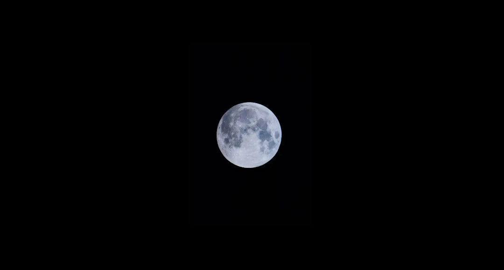

\# Hero.

Being a hero doesn't mean working every day.

In fact, heroes only have the opportunity to shine when villains appear, so during most of their time—when there are no villains—they don't actually have that much to do.

As such, heroes tend to spend most of their villain-free time quite leisurely.

Low-ranking heroes who can barely survive on their association salary typically have primary jobs elsewhere and treat hero work as a side gig.

And even beyond these low-ranking heroes, the A-rank and above heroes responsible for protecting the Republic of Korea similarly spend their free time doing their own things.

Icicle, Lee Seol-ah. She spends most of her villain-free time running her company. Her Yu-seong Corporation, which has already deeply penetrated political and financial circles, has become so dependent on her influence that it can hardly function without her. Consequently, Lee Seol-ah practically lives at her company.

Shadow Walker, Kim Ja-hyun. Living like Dracula—sleeping during the day and active at night—he typically spends his time hanging out with his girlfriend. Otherwise, he trains his abilities.

And finally, Stardust, Shin Ha-ru.

She too spends her non-hero time doing other things. Most notably, college life. Now in her fourth year, a graduating senior, she attends classes and completes assignments, living like an ordinary college student.

But who is Stardust?

The most special among the three A-rank heroes in the Republic of Korea, the only one close to S-rank. And the most righteous among them.

Being who she is, unlike other heroes who briefly spring into action when villains appear but otherwise forget about hero work and focus on their daily lives, she was different. That is, while also balancing college life, she never forgets her hero identity and regularly visits the association office or studies how to catch villains from home.

In other words, currently.

In her office at the association, Shin Ha-ru was sitting at her computer, working.

"Ms. Stardust. If you need anything, please don't hesitate to call."

"Yes. Thank you."

After the association employee left.

She clicked her mouse again and, as always, entered a particular website.

[Egostic Fan Cafe]

"....."

Despite not having visited for quite some time, the familiar yellow interface welcomed her like a hometown.

The reason she entered this cafe was simple: to gather information.

What information? Obviously, information about Egostic.

"Haah..."

She is a hero.

As such, her mission is to capture villains who operate across the country causing terror and throw them into detention centers.

And for Shin Ha-ru, currently the top hero in the Republic of Korea, to focus specifically on Egostic, the top villain, is as natural as the attraction between the north and south poles of a magnet. In fact, even if she spent all day thinking about Egostic, no one would blame her. They might even praise her.

Having finished this elaborate self-justification for browsing the Egostic fan cafe, she decided to shed her guilty conscience and first look at the popular posts.

At a glance, most seemed useless.

Egostic terror screenshots, Mangostick cosplay, shipping with Ego-stream members...

Still, just in case, she diligently checked them all, liking posts she approved of and leaving comments to refute those she didn't.

Again, she wasn't just playing around. She was strictly gathering information about a villain as a hero.

After thoroughly reading all the popular posts.

Returning to the main screen, she suddenly felt empty.

...While she was struggling to gather even the smallest bit of information about Egostic, his teammates probably already knew everything about him.

As this thought crossed her mind, Shin Ha-ru felt her chest tighten.

I'm supposed to be the Egostic expert.

Yet compared to them, I barely know anything about him.

"Sigh...."

'We're like family. Very close.'

The echo of Egostic's voice in her ear made her feel bad again.

...Haah. Anyway, Egostic is a villain who has committed multiple acts of terror. Being a villain, he needs to be caught...

"...."

She didn't know.

Strangely, whenever she thought about Egostic, her mind seemed to turn stupid.

Despite acting like a villain in every way, he would appear at crucial moments to save her.

...Now, when the moment had come to capture him with her own hands, she wasn't even sure if she could do it.

"...What am I thinking."

Right. No matter what, he's a villain. A walking time bomb. Already with dozens of criminal records.

As a hero, for the sake of the public who support her, she shouldn't be like this.

Yes. Back to work.

She focused on the monitor again.

.... Alright, what should I look into next?

Maybe I'll read the reports from the association again.

Thus, in her cozy office where sunlight streamed through the window, making her blonde hair shimmer.

Basking in the warm sunlight, Shin Ha-ru began working diligently again.

As she was reading documents.

Suddenly, the monitor just turned off.

"....?"

What's this? Is it broken?

As she stared at the monitor, trying to figure out what was wrong.

Pop-.

The light came back on the monitor.

Ah, it's back on.

Just as she thought that.

She realized something strange.

The screen that had been displaying white documents until just now.

Where did those documents go?

On the screen, now dyed completely black.

Only a large, lonely moon was floating.

"....What is this?"

The moon that suddenly appeared on her monitor.

Looking at it, Shin Ha-ru immediately felt ominous.

Something is strange.

And at that moment, from her monitor and the association speaker on the ceiling, came a sound like metal scraping.

[Ah....]

[Ah...my children...]

[I am the leader of the Moonlight Church, 'Celestial Moon Emperor'.... I greet you for the first time. Are you well....]

Moonlight Church.

Upon hearing those words, she immediately hardened her expression.

Along with Egostic, one of the villains the association was most vigilantly watching.

The organization that nearly destroyed Seoul last time by deploying the Moon Priestess.

"Ms. Stardust!!!"

"Yes, I'm listening right now."

After gesturing for the association employee who rushed in to be quiet, she focused on the Moonlight Church leader's words.

The speaker continued with a voice that still sounded like scraping metal.

[Yes... Ah, yes.... I am very pleased that everyone seems happy... Are you all spending your days with blessings at home and work?]

[The sight of rotten humans gathering and dragging each other into the abyss of evil is truly... truly delightful....]

[To you who lead the world to destruction every day... who are like calamities yourselves.]

[I have a gift for you....]

[Look at the moon in the sky above.]

[Isn't the moon very bright?]

The leader's words telling people to look at the moon in broad daylight.

At these words that seemed like an incomprehensible Zen riddle, Shin Ha-ru frowned.

Suddenly.

The moment those words ended.

"....Huh?"

The fierce sunlight that had been blazing until just now suddenly disappeared. Everything turned black.

The world suddenly plunged into darkness.

"....Did it become night?"

[....Keukeukeu.]

[This is the first gift I give to you dull people....]

[And let me give you one more.]

[From this terrible world where everyone tries to kill each other...]

[I will give you an opportunity to escape and find the path to salvation...]

[All those who have not received salvation... join the Moonlight and the path of salvation will open for you too.]

[For apostates, there is only death.]

And as the leader's words ended.

From one side of the city came a bizarre and massive howl.

Guwooooooooooo-

Kiiiiieeeeeeeek

"Ms. Stardust!"

"Yes, I'm leaving right now!"

Already fully suited up, she immediately threw herself into the pitch-black sky without a single light.

"....."

The city suddenly plunged into thick darkness.

Flying above it, Shin Ha-ru headed toward the source of the bizarre, massive noise.

Her expression looked more anxious than ever.

This is ominous.

More ominous than ever before.

Her intuition was warning her so.

\***

The house was suddenly enveloped in darkness.

[All those who have not received salvation... join the Moonlight and the path of salvation will open for you too.]

[For apostates, there is only death.]

As the leader's words ended.

"Shit. We're really screwed."

I cursed.

No, damn it. Why really...

"Oppa! What's happening?"

"Da-in! The outside suddenly went dark, what's going on?"

"Hey... what the hell is happening right now?"

While our Ego-stream was in chaos.

[Breaking news! There are reports of an unidentified monster appearing in a region of Seoul!]

Hearing the voice from the radio, my face hardened.

Moonlight Church. Sudden darkness. Monster.

Shit. This is definitely that thing from the Moonlight Church.

One of the apocalyptic soldiers that appear in the final battle of Phase 2.

"...Eun."

"Yes?"

"Seo-eun, grab all the silver you have. Quickly!!!"

We're screwed.

If we don't stop this quickly, there's no hope.

I hurriedly moved toward the basement.

No, damn it, you church leader bastard.

Why are you bringing out the ultimate weapon now?

Thus, in the darkness-covered city.

Two figures were setting out to prevent disaster.